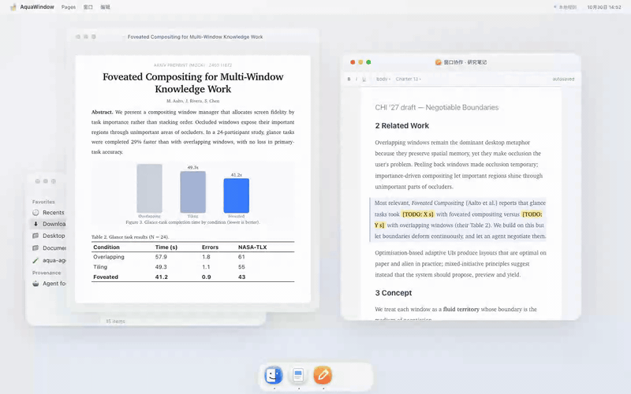
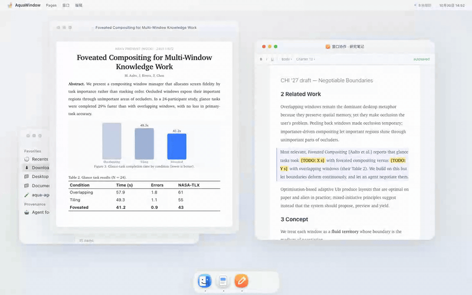
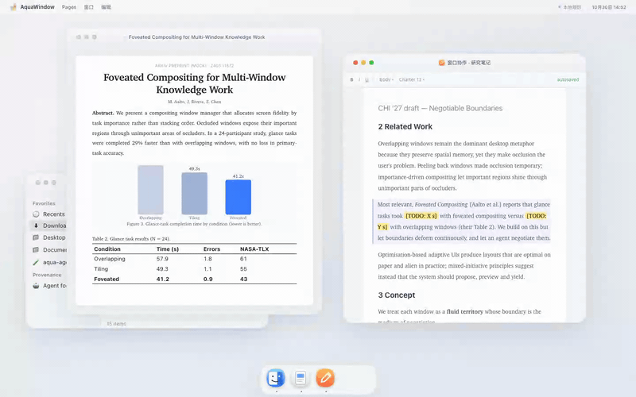
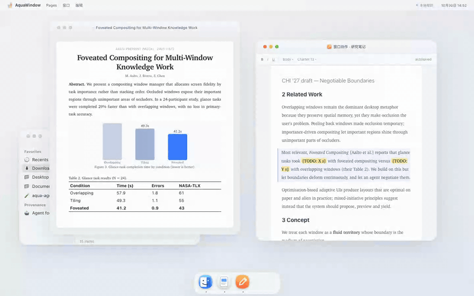

<h1 align="center">AquaWindow</h1>
<p align="center"><strong>以柔性边界连接人与 Agent 的协作</strong></p>
<p align="center">同济大学 · 设计创意学院（D&amp;I）</p>
<p align="center">
  <a href="https://www.tongji.edu.cn/"></a>
  <a href="https://www.tongji.edu.cn/"></a>
  <a href="https://github.com/Shoreee/AquaWindow/actions/workflows/pages.yml"></a>
  <a href="LICENSE"></a>
</p>
<p align="center"><a href="https://shoreee.github.io/AquaWindow/">体验在线原型</a> · <a href="#交互指南">交互指南</a> · <a href="#本地运行">本地运行</a></p>

AquaWindow 探索 AI 协作者如何通过窗口边界融入桌面。窗口被视作能够退让、透出内容、携带上下文、相互连接与拆分的表面。柔软的膜、流动的白色材质和克制的光学色散，构成这些变化共同的视觉语言。

这是一个在浏览器中运行的交互研究原型。文档、文件和应用窗口共同组成模拟工作区，使人们无需授予系统级控制权限，也能体验这套交互语言。

## 设计理念

**边界是协作发生的地方。** 窗口边缘可以为当前任务让出空间、露出下方的重要区域，或表达与另一窗口的关系。协作由此发生在工作区中。

**动效应解释因果。** Agent 的材质从核心延伸出去，作用于对象，再返回核心。窗口移动时，膜逐渐包裹它，并在抵达目标位置后释放。动效让人看清作用者、作用位置和操作完成的时刻。

**人与 Agent 共用一套材质语言。** 手动调整窗口大小和 Agent 调整边界使用相同的流动边缘。直接操作必须即时响应：拖动不等待膜的扩展动画结束。只有明确唤起 Agent 时，光标才连续变形为 Agent 核心；普通手动操作不会唤起它。

**连接应当可逆。** 相关窗口可以沿着流动的接缝黏合，并一起移动。沿接缝拉动会让连接在张力下打开；提前松手，接缝会回流；拉到末端，表面才分离。交互由边界本身承载，不使用拉链齿或额外的生物图标。

## 动态演示

以下 GIF 录制自运行中的原型，并非概念动画。当前界面使用中文标签。

### 从光标到协作者

按住空格键，让光标逐渐变为 Agent，选择对象并查看自适应布局方案。



### 随窗口移动的膜

手动移动窗口时，包裹的前沿从最初的指针位置扩散。自动移动则从窗口一角开始，先包裹窗口，再将其带到目标位置。



### 相连表面，共同移动

融合相关窗口，让它们作为一组移动，再拉开接缝。拉动距离不足时会恢复连接；拉到末端后才会分离。



## 交互指南

| 输入 | 结果 |
| --- | --- |
| 按住 **Space（空格）** | 光标变为 Agent，进入对象选择状态。 |
| 按住空格且尚未触发扩散时点击窗口 | 添加或移除对象；每次改变都会重置选择倒计时。 |
| 不选择任何对象 | 以当前窗口为对象，按工作区模型检索相关窗口，不自动全选。 |
| 扩散后按 **← / →** | 在本次有效候选间切换；预览不会自动轮播或被迟到响应替换。 |
| 松开 **Space** | 接受当前方案，等待动画完成。 |
| 按 **Esc**、**⌘/Ctrl Z**，或点击撤销提示 | 取消或撤销操作。 |
| 拖动标题栏或缩放手柄 | 立即操作实际窗口，同时显示膜状反馈。 |
| 将相关窗口的边缘靠近并松手 | 预览并建立表面连接。 |
| 右键点击标题栏，或在标题栏上按 **Shift F10** | 打开窗口操作菜单：收纳、融合、调整纵深、最大化或关闭。 |
| 将窗口缩小到接近角落的小尺寸后松手 | 将其收入与 Agent 共用的会话胶囊。 |
| 拖动任一已融合窗口的标题栏 | 一起移动相连窗口。 |
| 从接缝一端拉到另一端 | 拉到底立即分离，无需松手；中途松手则接缝回流。也可按 **End** 完成键盘操作。 |

### 当前 Agent 候选范围

本轮 Agent 组织现有窗口，不生成文档或信息视图。运行时接受带方向、比例和主窗口参数的布局、胶囊收纳、纵深组织，以及已有的融合、真实掀角和用户已标记区域操作；后台持续预计算真实模型结果；布局变化小且任务内容兼容时复用，否则基于已有模型对话发送差异请求。没有本地兜底候选，超过 10 秒仍没有结果会显示 Error。模型建议不代表实验已经证明某一种技术最适合当前任务。

自动让界、生成内容的分生/汇合、边缘裁剪式揭示暂不进入 Agent 候选。真实掀角与融合共用手动交互实现，区域透出只引用已有用户标记。不会为增加多样性强行使用技术。调用参数、工程诊断及实验评价接口见 [架构说明](docs/agent/workspace-architecture.md)。

### 会话胶囊

胶囊保留实际页面、文档身份和阅读位置。每加入一个页面，就增加一个分段与相应容量。

- 将鼠标悬停在分段上，可通过标题辨认页面。
- 把另一个窗口或胶囊拖到胶囊上，可通过流入动画将其加入。
- 将胶囊放到窗口标题栏上，可把它变为附件；向外拖动可解除附着。
- 胶囊可包含其他胶囊，也可与其他胶囊并行存在。从嵌套胶囊中提取内容时，内部容器及其页面会保留；系统会拒绝循环包含。
- 拖动或缩放胶囊时，页面预览会暂时隐藏。
- 按住 **Option/Alt** 拖动某个分段，可只释放该页面，包括原来的宿主页。
- 将胶囊拉伸到超过容量，可依次释放页面；也可以使用释放按钮。
- 撤销可恢复此前的会话状态。

### 胶囊承载嵌套上下文

小容器可以附着在工作窗口的标题栏上。收纳该窗口时，附件关系会保留；容器本身也可以嵌套。流入、解除附着和释放都沿用收纳时的膜状语言。



## 本地运行

使用当前的 Node.js LTS 版本和 pnpm 9 或更高版本。

```bash
pnpm install
pnpm dev
```

打开终端输出的 Vite 地址，通常是 `http://localhost:5173`。开发模式也会在 `8787` 端口启动可选的本地 Agent 服务。Agent 布局必须接入 DeepSeek；未接入时不会生成本地方案。

如需在本地运行生产构建：

```bash
pnpm build
pnpm start
```

打开 `http://127.0.0.1:8787`。GitHub Pages 会直接提供浏览器构建版本。

## 桌面与实验

默认桌面提供自由窗口交互。右下角 **设置** 控制 Agent；开启后长按空格探索布局，AI 问答可调用 DeepSeek。关闭 Agent 会阻止问答请求并取消进行中的回答。

底部任务栏的 **实验** 打开独立实验工作区：先选择论文阅读或文件管理，再逐题完成。交互方式在实验窗口内选择，答题中也可切换；右下角系统控制提供截图、撤销和窗口管理。关闭实验窗口会返回原桌面。重点区域采用液态边界，双击或聚焦后按 Delete 可移除；Ctrl/⌘ Z 撤销。

Shift+S 在当前窗口框选保留区域，Alt+S 框选扣洞；标题栏右键菜单也提供这两个入口。Ctrl+Shift+S 截图。普通重叠不自动让界，也不会根据默认内容区域自动挖洞。

窗口角落常态不显示按钮。悬停在靠内的角落会产生朝向鼠标的轻微折起，按下拖动可真实掀角；最外侧边缘用于缩放。折起保留反射背面并随窗口尺寸变化，支持 Shift 松手保持和 Esc 回弹。融合接缝从端点拉开，过程中窗口保持原位，到末端松手后分离。

鼠标 SVG 来自 [Bibata](https://github.com/ful1e5/Bibata_Cursor)，应用和系统控件优先使用 [OpenHarmony](https://github.com/openharmony) 公开资源，补充图标来自 [Microsoft Fluent UI](https://github.com/microsoft/fluentui-system-icons)。来源、配色修改与许可证保存在 `public/cursors/`、`public/harmony/`、`public/browser-icon/` 和 `public/system-icons/`。浏览器的地球图标来自 GNOME Web。阶段比较方案见 [研究建议](docs/research/stage-technique-study.md)。

## 可选的 DeepSeek 集成

DeepSeek **默认关闭**。打开右下角 **设置**，输入并保存 API 密钥，再明确启用服务提供方。仅保存密钥不会发起请求。

访客输入的密钥只保存在当前页面的内存中，不会写入 localStorage、sessionStorage、代码仓库或构建产物；刷新页面后即清除。使用页面输入的密钥时，请求会直接发往 DeepSeek 官方 HTTPS 接口。清除或替换密钥会停用访问，并中止未完成的请求。启用服务提供方后，当前工作区上下文会用于生成候选方案。

本地开发也可以在被 Git 忽略的环境文件中配置服务端密钥：

```bash
cp .env.example .env.local
# 在本地设置 DEEPSEEK_API_KEY；不要给密钥使用 VITE_ 前缀。
```

服务端模式的回放记录存放在被忽略的 `log/` 目录。页面输入的密钥不会写入这些记录。发布流程会在部署前扫描源码和构建产物中的凭据。

## 实现方式

界面结合原生 DOM 文档与 WebGL 材质层。窗口移动和形状变化会改变真实的布局状态；流动核心与延展出的带状材质共享一套连续材质模型。窗口主体使用轻量的矢量轮廓裁切，而非对整个窗口应用栅格位移滤镜。

```text
src/
  kernel/              窗口状态、手势、历史记录与撤销
  agent/adaptive/      上下文、增量模型协议、服务接入与动效编排
  field/               WebGL 核心、材质流动与带状渲染
  shell/               桌面、窗口表面、胶囊与张力接缝
  apps/                模拟应用与文档状态
  techniques/          合成、纵深、透出与布局几何
server/                可选的本地服务与回放记录
scripts/               浏览器回归检查与演示录制
```

`AgentMotion` 是布局动效与可见材质反馈之间的共享约定。表面连接会改变实际窗口轮廓，而不是在窗口上方另画一座桥。连接与窗口共用底层状态，因此移动、关闭、撤销或拆分一组窗口时，操作的是同一份状态。文档树独立于展示帧进行缓存，以保留编辑内容，并避免动画期间重复渲染文字。

## 验证与贡献

```bash
pnpm typecheck
pnpm test
pnpm build
pnpm check:secrets
```

启动开发服务器后，可运行覆盖各条交互路径的浏览器检查：

```bash
pnpm test:peel
pnpm test:zipper
pnpm test:desktop
pnpm test:study
pnpm test:files
pnpm test:agent-workspace
pnpm test:boundary
pnpm test:fusion
pnpm test:capsule
pnpm test:capsule-tree
pnpm test:fluid
pnpm test:cursor
pnpm test:render
pnpm test:keys
```

浏览器检查通过 `playwright-core` 使用本机安装的 Chrome；服务提供方检查使用测试数据，不调用付费模型。设置 `AW_URL` 可测试另一个正在运行的实例。GIF 录制脚本还需要 `ffmpeg`。在 `4177` 端口运行生产预览时，可用 `pnpm capture:readme` 重新生成演示录屏。

原型仍在完善中。仓库里的研究文档和数值示例是测试素材，不代表已发表的实验结果。动效与渲染测量的记录见[交互说明](docs/embodied-interaction.md)和[性能说明](docs/animation-performance.md)。

欢迎提交问题与贡献，尤其是关于动效连续性、边界可辨性、无障碍替代操作，以及这些交互如何支持真实协作任务的建议。

## 项目与相关作品

项目由 [Shoreee](https://github.com/Shoreee) 创建。作者的另一项交互作品是多人共享绘画游戏 [LastStroke](https://github.com/Shoreee/LastStroke)。

AquaWindow 基于 [MIT 许可证](LICENSE)发布。

## Agent 工作区模型

Agent 使用本地 Task-Driven Workspace Model，相关窗口与内容摘要有独立预算；后台预计算、兼容结果复用与增量实时请求共同工作。保留长按选窗、松开采用与 Esc 撤回，预览列表不会被迟到响应替换。工程依据、已启用能力与待实验参数见 [架构说明](docs/agent/workspace-architecture.md)。DeepSeek Harness 的官方 SDK 可接入，但默认工具超出本轮权限范围，核查结论见 [接入说明](docs/agent/deepseek-harness.md)。
