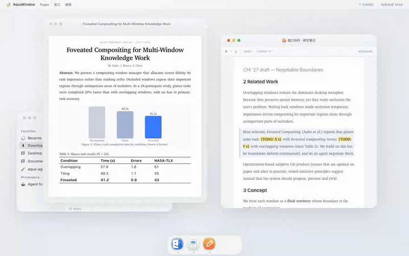
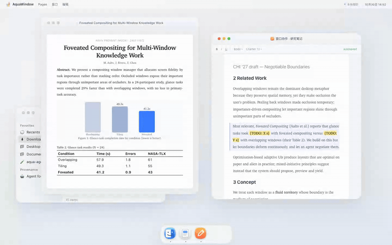
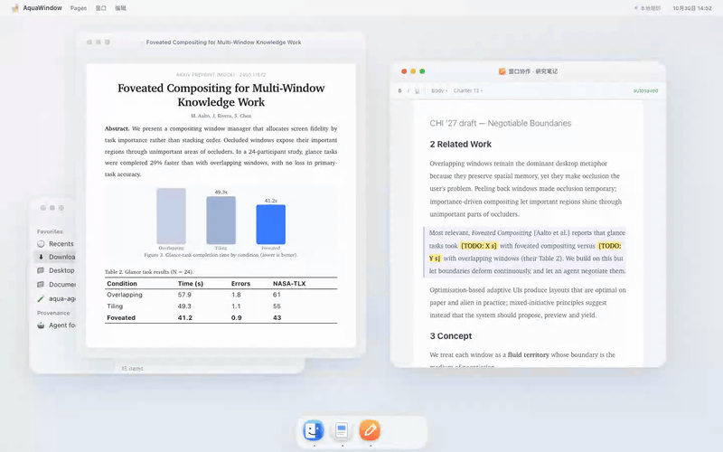
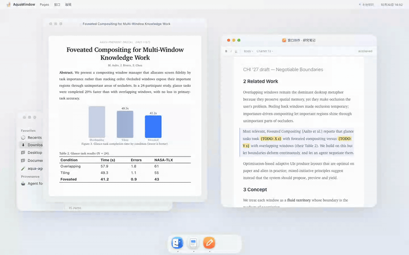

<h1 align="center">AquaWindow</h1>
<p align="center"><strong>Soft boundaries for shared human–agent work</strong></p>
<p align="center">Tongji University · College of Design and Innovation (D&amp;I)</p>
<p align="center">
  <a href="https://www.tongji.edu.cn/"></a>
  <a href="https://www.tongji.edu.cn/"></a>
  <a href="https://github.com/Shoreee/AquaWindow/actions/workflows/pages.yml"></a>
  <a href="LICENSE"></a>
</p>
<p align="center"><a href="https://shoreee.github.io/AquaWindow/">Try the live prototype</a> · <a href="#interaction-guide">Interaction guide</a> · <a href="#running-locally">Run locally</a></p>

AquaWindow explores how an AI collaborator might inhabit a desktop through its boundaries. Rather than introducing another panel, it treats windows as surfaces that can yield, reveal, carry context, join together, and separate again. The interface makes these changes tangible through a shared language of soft membranes, flowing white material, and restrained optical dispersion.

This is an interactive research prototype built in the browser. Its documents, files, and application windows form a simulated workspace, allowing the interaction language to be explored without granting control over the operating system.

## Design philosophy

**Boundaries are places to collaborate.** A window edge can make space for a task, expose an important region underneath, or hold a relationship to another window. Collaboration becomes part of the workspace rather than a separate destination.

**Motion should explain causality.** An agent's material extends from its core, works on an object, and returns. A moving window is gradually enveloped in a membrane and released at its destination. The effect communicates what is acting, where it acts, and when the operation is complete.

**People and agents share a material language.** A manual resize and an agent-driven boundary adjustment use the same flowing edge. Direct manipulation remains immediate: dragging never waits for the membrane to finish spreading. The cursor retains its continuous transformation into the agent core when the agent is explicitly summoned; ordinary manual actions do not summon it.

**Connections should feel reversible.** Related windows can adhere along a living seam and travel together. Pulling along the seam opens the connection under tension. Releasing early lets it flow back; reaching the far end separates the surfaces. There are no zipper teeth or additional creature icons—the boundary itself carries the interaction.

## In motion

The GIFs below are recordings of the running prototype, not rendered concept animations. The current interface uses Chinese labels; the controls are described in English below.

### From cursor to collaborator

Hold Space to grow the cursor into the agent, choose objects, and explore adaptive layouts.



### A membrane that travels with the window

The swallowing front spreads from the initial pointer location during manual movement. Automatic relocation begins at a corner and envelops the window before carrying it.



### Related surfaces, shared movement

Fuse related windows, move them as one group, then pull their seam apart. An incomplete pull returns to the joined state; a complete pull releases the windows.



## Interaction guide

| Input | Result |
| --- | --- |
| Hold **Space** | Grow the cursor into the agent and enter object selection. |
| Click windows while holding Space, before the burst | Add or remove objects; each change resets the selection countdown. |
| Make no selection | All eligible windows are selected when the countdown expires. |
| **← / →** after the burst | Switch between seven independent candidates. Previews do not auto-cycle. |
| Release **Space** | Accept the current candidate and let its animation complete. |
| **Esc**, **⌘/Ctrl Z**, or the Undo prompt | Cancel or undo the operation. |
| Drag a title bar or resize handle | Manipulate the actual window immediately, with shared membrane feedback. |
| Move related edges close together and release | Preview and create a surface bond. |
| Right-click a title bar, or press **Shift F10** on it | Open window actions: collect, fuse, move through depth, maximize, or close. |
| Shrink a window to a small corner-sized surface, then release | Collect it into the same session capsule used by the agent. |
| Drag either fused title bar | Move the joined windows together. |
| Pull a seam from one end to the other | Separate only after reaching the end; otherwise it flows back. **End** provides keyboard completion. |

### Seven adaptive candidates

| Candidate | What changes |
| --- | --- |
| **Central reveal** | Open a rounded rectangular aperture in the upper surface to expose important content below, relocating it when useful. |
| **Corner reveal** | Peel open an outside corner. Only the cut edge receives material feedback; the underlying page stays plain. |
| **Yield** | Pull a boundary, with a one-sided travelling wave in its direction of motion. Adjacent edges can participate in a corner drag. |
| **Encapsulate** | Gather windows sequentially into a compact, editable session capsule. |
| **Branch** | Develop independent result windows from the original context through a soft division. |
| **Merge** | Bring results together and join relevant working surfaces with a detachable liquid seam. |
| **Permeate** | Move a surface through depth layers with a ripple-like transition. |

Anchoring remains the underlying selection relationship rather than occupying an extra layout candidate. Both reveal forms can be closed by dragging their exposed boundary.

### Session capsules

Capsules retain the actual pages, document identity, and reading position. Each incoming page adds a segment and increases the capsule's capacity.

- Hover a segment to identify its page by title.
- Drag another window or capsule onto the capsule to add it with a flowing ingress animation.
- Drop a capsule onto a window title bar to make it an attachment; drag it back out to detach it.
- Capsules can contain capsules or accompany other capsules. Nested extraction preserves the inner container and its pages; circular containment is rejected.
- Drag or resize the capsule; page previews hide during manipulation.
- **Option/Alt-drag** a segment to release just that page, including the original host page.
- Stretch the capsule beyond its capacity to release the pages in sequence, or use its release button.
- Undo restores the preceding session state.

### Capsules as recursive context

A small container can accompany a working window in its title bar. Collecting that window preserves the attachment, and containers can themselves be nested. Ingress, undocking, and release use the same membrane language as collection.



## Running locally

Use a current Node.js LTS release and pnpm 9 or later.

```bash
pnpm install
pnpm dev
```

Open the Vite URL printed in the terminal, normally `http://localhost:5173`. Development also starts the optional local agent service on port `8787`. No API key is needed for the deterministic local previews.

To run the production build locally:

```bash
pnpm build
pnpm start
```

Open `http://127.0.0.1:8787`. GitHub Pages serves the browser build directly.

## Optional DeepSeek integration

DeepSeek is **off by default**. Open **AquaWindow** in the top-left menu, enter an API key, save it, and explicitly enable the provider. Saving a key alone does not start requests.

A visitor's key stays in the current page's memory. It is not written to localStorage, sessionStorage, the repository, or build artifacts, and it is cleared on reload. Requests with a page-entered key go directly to the official DeepSeek HTTPS endpoint. Clearing or replacing the key disables access and aborts outstanding work. Enabling the provider sends the current workspace context for candidate generation.

For local development, a server-side key can alternatively be configured in the ignored environment file:

```bash
cp .env.example .env.local
# Set DEEPSEEK_API_KEY locally; never use a VITE_ prefix for a secret.
```

Server-mode replay traces are stored under the ignored `log/` directory. Page-entered keys are not written into those traces. The publication workflow scans source files and build artifacts for credentials before deployment.

## Implementation

The interface combines native DOM documents with a WebGL material layer. Window movement and shape changes affect actual layout state, while the flowing core and donated ribbons share a continuous material model. The body is clipped with lightweight vector contours rather than a full-window raster displacement filter.

```text
src/
  kernel/              Window state, gestures, history, and undo
  agent/adaptive/      Context, local candidates, provider access, and choreography
  field/               WebGL core, material flow, and ribbon rendering
  shell/               Desktop, window surfaces, capsules, and tension seams
  apps/                Simulated applications and document state
  techniques/          Compositing, depth, reveal, and layout geometry
server/                Optional local provider service and trace recording
scripts/               Browser regression checks and demo capture
```

`AgentMotion` is the shared contract between layout choreography and visible material response. Surface bonds deform the actual window silhouettes rather than drawing a bridge over them. They live alongside the windows, so moving, closing, undoing, or separating a group operates on the same underlying state. Document trees are memoized independently of presentation frames to preserve editing and avoid re-rendering text during animation.

## Validation and contribution

```bash
pnpm typecheck
pnpm test
pnpm build
pnpm check:secrets
```

With the development server running, browser checks cover the interaction paths:

```bash
pnpm test:e2e
pnpm test:boundary
pnpm test:fusion
pnpm test:capsule
pnpm test:capsule-tree
pnpm test:fluid
pnpm test:cursor
pnpm test:render
pnpm test:keys
```

Browser checks use a locally installed Chrome through `playwright-core`; provider checks use fixtures rather than paid model calls. Set `AW_URL` to test another running instance. The GIF capture script additionally requires `ffmpeg`. With a production preview running on port 4177, use `pnpm capture:readme` to regenerate the recordings.

This prototype is still being refined. The included research documents and numerical examples are fixtures, not claims about published experimental results. Notes on choreography and rendering measurements are available in [the interaction notes](docs/embodied-interaction.md) and [performance notes](docs/animation-performance.md).

Issues and contributions are welcome, particularly around continuity, boundary legibility, accessible alternatives, and how these interactions support real collaborative tasks.

## Project and related work

Created by [Shoreee](https://github.com/Shoreee). For another interaction-led project by the author, see [LastStroke](https://github.com/Shoreee/LastStroke), a shared-drawing multiplayer game.

AquaWindow is released under the [MIT License](LICENSE).
